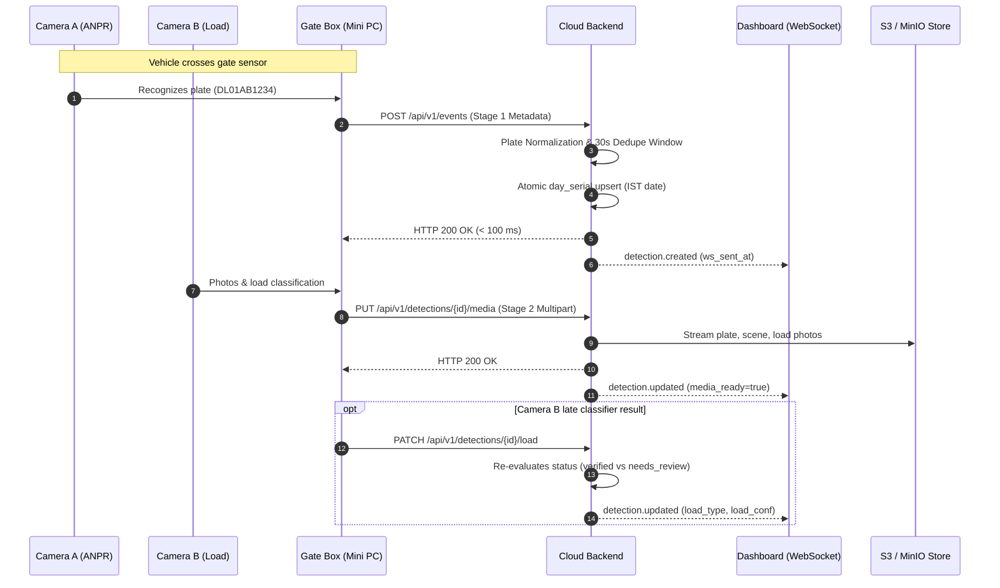

# Vehicle Gate Monitoring Cloud Backend - Architecture

## 1. System Overview

The Forest Gate Monitoring System cloud backend is a high-performance, single-process FastAPI service engineered for edge vehicle telemetry. It provides:
1. **Low-Latency Ingestion (< 100 ms)** for high-speed edge recognition (Camera A ANPR on-chip and Camera B load classifier).
2. **Resilience over Unreliable 4G Gate Links**: Complete idempotency, retry safety, server-side deduplication, and out-of-order media handling.
3. **Atomic, Gap-Free Day Serials**: Sequential local-day numbering resetting every IST midnight per gate, even under 200+ concurrent requests.
4. **Real-Time WebSocket Streaming**: Dispatches live detection and health events to browser dashboards with non-blocking per-client bounded queues.

---

## 2. Edge-Cloud Split & Ingestion Protocol



### Stage 1: Fast Metadata (`POST /api/v1/events`)
- Contains vehicle telemetry: `event_uid`, `camera_id`, `captured_at`, `plate_raw`, `plate_conf`, `vehicle_type`, `load_type`, `load_conf`, `clip_ref`.
- **Idempotency**: `event_uid` is uniquely indexed. Repeat POSTs return HTTP 200 with the exact same record without creating duplicates.
- **Deduplication**: Lookback search on `(gate_id, camera_id, normalized_plate)` within a 30-second window. Merges higher-confidence plate and load detections into the primary record.
- **Gap-Free `day_serial`**: Allocates sequential numbers using atomic PostgreSQL / SQLite upsert:
  ```sql
  INSERT INTO daily_counters (gate_id, local_date, last_no)
  VALUES (:gate_id, :local_date, 1)
  ON CONFLICT (gate_id, local_date)
  DO UPDATE SET last_no = daily_counters.last_no + 1
  RETURNING last_no;
  ```

### Stage 2: Media Upload (`PUT /api/v1/detections/{id}/media`)
- Multipart upload for `plate`, `scene`, `load_thumb`, `load_full` (any subset).
- **Out-of-Order Safety**: If 4G network drops cause media to arrive *before* the Stage 1 event, the endpoint creates a placeholder detection stub (`media_ready=True`), saves media objects, and completes the metadata seamlessly when Stage 1 arrives later.

---

## 3. Data Integrity & Validation Rules

### Plate Normalization & Regex Validation
- **Normalization**: Strip whitespace, hyphens, dots; uppercase.
- **Standard Indian Series**: `^[A-Z]{2}\d{2}[A-Z]{1,3}\d{4}$` (e.g. `DL01AB1234`, `KA05M5678`).
- **Bharat (BH) Series**: `^\d{2}BH\d{4}[A-Z]{1,2}$` (e.g. `22BH1234AA`).
- **Invalid Plates**: Retained in the database with `plate_valid=False` and flagged for review.

### Status Evaluation
- A detection receives `status = needs_review` when:
  - `load_conf < 0.60`, OR
  - `plate_valid == False`, OR
  - `plate_conf < 0.85`.
- Otherwise: `status = verified`.
- When modified by a reviewer or admin: `status = corrected`.

---

## 4. Real-Time WebSocket Architecture

- Path: `/ws/live?token=JWT`.
- Authenticates short-lived JWT token.
- **Non-Blocking Guarantee**: Each connected subscriber is allocated a bounded queue (`asyncio.Queue(maxsize=100)`).
- When a broadcast occurs, messages are queued via `put_nowait()`. If a client becomes slow or unresponsive and its queue fills up, it is safely disconnected without slowing down ingestion or blocking other dashboard users.
- Automatic background ping every 20 seconds.

---

## 5. Security & Access Control

- **Argon2 Password Hashing**: Utilizes `argon2-cffi` memory-hard hashing.
- **Token Lifespans**: 15-minute JWT access tokens, 7-day JWT refresh tokens.
- **Lockout Mechanism**: Accounts are automatically locked for 15 minutes after 5 consecutive failed login attempts.
- **Role-Based Access Control**:
  - `viewer`: Read-only queries, live dashboard viewing.
  - `reviewer`: Reviewer corrections (`PATCH /detections/{id}`) and CSV export.
  - `admin`: Full administrative access, user management (`/users`).
- **Device Authentication**: Gate boxes authenticate via `X-API-Key` headers; keys are hashed using SHA-256 before storage and lookup.
- **Presigned URLs**: S3/MinIO photo URLs are never public and expire after 10 minutes (600 seconds).

---

## 6. Latency Instrumentation

- Records `captured_at` (device timestamp), `received_at` (server arrival timestamp), and `ws_sent_at` (WebSocket dispatch timestamp).
- Computes real-time p50 and p95 latencies over a rolling 1-hour in-memory buffer via `GET /api/v1/metrics/latency`.
- Enables monitoring of 4G uplink latency vs cloud processing time.
